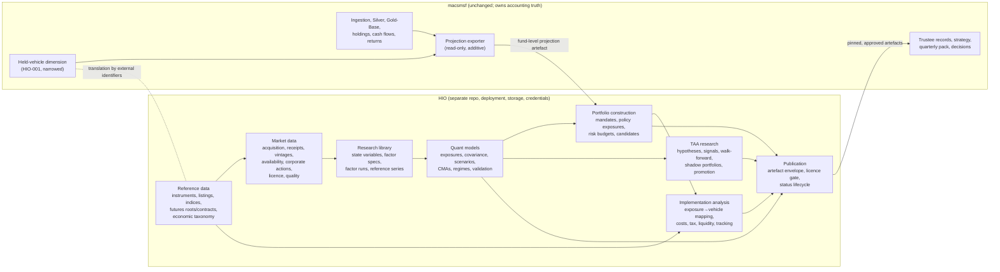

# HIO: five-year architecture direction and programme reassessment

**Status:** proposal for joint review. Nothing was implemented. No code, schema, migration,
deployment, repository layout or roadmap was changed.
**Prepared:** 18 October 2026, in response to `hio-five-year-architecture-direction-claude-prompt.md`.
**Supersedes, in part:** `hio-strategic-review-research-and-portfolio-construction-2026-10-18.md`
(the earlier review). Section 1 says which conclusions survive.

### State verified for this review

| Item | Value |
|---|---|
| `macsmsf` `main` HEAD | `1502ab8`, clean |
| Latest refresh | `bronze.ingestion_run` completed 2026-10-10 07:16 UTC |
| Latest price | 2026-10-09 |
| `silver.dim_instrument` | absent from the authoritative database (HIO-001 not applied) |
| HIO-001 registry | exactly the 11 held instruments (`silver/instrument_registry.py`) |

None of this has changed since the earlier review. Anything cited below as "current" was
re-checked today.

### Evidence tags

| Tag | Meaning |
|---|---|
| **[OBS]** | observed in the repository or the database |
| **[INF]** | inferred from observed evidence |
| **[PROP]** | proposed by this document |
| **[EXT]** | external claim about vendors, licences or markets. **Needs current validation before it is relied on** |

---

## 1. Executive recommendation

### 1.1 Recommendation

Build HIO as a **separate system**:
- its own repository;
- its own deployment domain;
- its own storage and catalogue;
- its own credentials.

Structure it as a **modular monolith with independently runnable jobs**:
- one codebase with enforced bounded-context modules;
- immutable, content-addressed datasets in object storage;
- a small HIO-owned Postgres catalogue for lineage, availability and runs;
- scheduled ingestion jobs that run off the operator's machine from day one.

This is Option A+ in section 4. HIO publishes **versioned, enveloped artefacts**. Consumers, of
which the SMSF is the first, pin artefacts by id. The SMSF gives HIO a **read-only, fund-level
projection** as an exported artefact, not database access.

Three things should be decided **now**, because they are expensive to reverse:

1. **The temporal semantics of an observation:**
   - valid time;
   - publisher availability time;
   - retrieval time;
   - vintage.

   Point-in-time capture is the one resource that cannot be bought back later: for most
   sources, what was knowable on a date can be recorded only on that date. The capture clock
   should start in the first 90 days, even though TAA research is a year-4 capability.
2. **The instrument-master boundary, before HIO-001 is activated.** HIO-001 is
   SMSF-scoped in practice: 11 held instruments, corroborated against SF360 Bronze and
   `macsmsf` alias dicts **[OBS]**. Proposal:
   - narrow it to the SMSF's **held-vehicle dimension**;
   - give **reference-data ownership** (instruments, listings, indices, futures contracts,
     economic taxonomy) to HIO;
   - join the two through a translation contract keyed on external identifiers.

   Activating HIO-001 as it stands would create the dual ownership the brief warns against.
3. **Licence class as a first-class attribute.** Every dataset and every derived artefact carries
   a licence class, and the most restrictive input's class propagates to outputs. The
   publication gate enforces it. Retrofitting this after artefacts have left HIO is not
   possible.

### 1.2 The earlier review: retain, modify, reject

| Earlier conclusion | Verdict | Reason |
|---|---|---|
| Keep research out of the accounting medallion; preservation of `macsmsf` is non-negotiable | **Retain**, and strengthen | Now a system boundary, not a schema boundary |
| Point-in-time discipline, vintages, append-on-change (`sql/043` pattern) | **Retain** | The `sql/043` lesson (a yfinance revision moved a settled receivable) is direct evidence |
| Provenance and licence records per source | **Retain**, and strengthen | Licence propagates to derived artefacts (§1.1, decision 3) |
| Illiquidity, valuation, tax, manager and governance risk handled outside factor regressions | **Retain** | MXT remains the clearest evidence **[OBS]** |
| Scepticism about predictive TAA; the fund's own record cannot validate TAA | **Retain for decision authority. Modify for research** | HIO can and should research TAA (hypotheses, PIT walk-forward, shadow portfolios). Only *authority to act* stays with each portfolio's governance |
| "About seven macro factors" | **Reject as a library ceiling. Retain as a modelling default** | The earlier review conflated the **factor library** with a **model's factor set**. The library should hold dozens of specified series; any one model fits a parsimonious, justified subset |
| Defer futures construction until a decision needs it | **Reject** | Contract-level futures are the cleanest route to own-built, tradable excess returns across rates, equity, FX and commodities. A small proof of concept is among the most informative early investments (§6, §7) |
| Research local-only, files first, no promotion to Neon | **Reject "local-only". Modify "files first"** | HIO needs durable off-machine storage and scheduled capture from day one. `macsmsf`'s own known gap is source files only on local disk (`CLAUDE.md`). Immutable files remain the system of record, alongside a real catalogue |
| Fund cadence (11 positions, a handful of decisions a year) as a limit | **Reject for HIO. Retain for SMSF implementation** | It governs SMSF implementation and governance, not HIO's capability |
| WP-2 "disclosed vs estimated exposure agree within 2 s.e." | **Correct** | Not numerically interchangeable (§1.3) |
| WP-1 "global equity series matches IVV.AX or BGBL" | **Correct** | Index definitions differ (§1.3) |
| F5 "inflation-mimicking … plus a commodities and gold leg" | **Correct** | Gold is not an inflation proxy (§1.3) |
| "TSMOM matches DBMF in 2022" as an acceptance criterion | **Correct** | Not a valid test (§1.3) |
| WP-3 "replay and exposure-shock agree within tolerance" | **Correct** | Independent models need not agree (§1.3) |
| Defer Azure, Prefect and orchestration | **Modify** | Defer a *general* orchestrator, but HIO needs scheduled execution now (§4) |

### 1.3 Methodological corrections

1. **Holdings-based exposure and returns-based beta measure different things.**
   - Disclosed duration is in years. A regression beta on a bond factor is dimensionless and
     relative to that factor's own duration. Under parallel shifts, β ≈ D_portfolio / D_factor,
     but that breaks down with curve-shape exposure, credit spread duration, or a sovereign that
     differs from the factor's.
   - An equity *weight* is not an equity *beta*. A sleeve's beta to a broad index depends on its
     composition, its hedging and AUD translation.
   - Returns-based estimates also pick up things holdings disclosures omit: derivative overlays,
     trading between disclosure dates, and stale pricing, which biases beta down.

   **The right comparison** is a stated *translation model* plus a pre-registered expected
   direction for any difference. The difference is a diagnostic, not a pass/fail tolerance.
2. **Proxies must match index definitions.**
   - IVV is the S&P 500. BGBL tracks a developed-markets ex-Australia index **[EXT]**. The French
     "developed market" factor uses its own universe and weighting **[EXT]**. These are three
     different objects.
   - Validation compares like with like, for example S&P 500 TR in USD × FX against an
     AUD-listed S&P 500 fund, unhedged and hedged. Otherwise it reports and quantifies a known
     definitional mismatch.
3. **A rolled futures return is not the change in an adjusted continuous price.**
   - The excess return is the compounded return on the contract actually held each day, using
     same-contract price changes, with an explicit roll schedule.
   - A back-adjusted series exists for charting and signals. Its percentage changes are not
     returns: additive adjustment distorts them, and levels can go negative.
   - Total return = excess return + collateral return, as a separate, explicit leg.
4. **Gold is not interchangeable with an inflation index.**
   - CPI is a state variable. An inflation *factor* is either a mimicking portfolio (tradable
     returns projected on inflation surprises) or a breakeven construction (nominal minus
     inflation-linked excess return).
   - Gold is its own tradable series, with its own real-rate and USD sensitivity. Its inflation
     relationship is an empirical question, not a construction rule.
5. **Agreement between a trend index and DBMF is not an acceptance test.** DBMF replicates a CTA
   index using a small futures set and its own method **[EXT]**. An own-built TSMOM is validated
   by:
   - (a) unit tests of signal, volatility scaling and roll against the specification;
   - (b) **replicating a published study on its own sample and specification**;
   - (c) only then, comparing it with other trend series as a plausibility check, with
     differences expected.
6. **Independent risk models need not agree by construction.** The repository's "two figures
   that must agree" method (`CLAUDE.md`) is correct for **identities**:
   - accounting balances;
   - attribution sums;
   - FX decomposition;
   - total = excess + collateral.

   It is wrong for **independent estimates**, such as historical replay against a factor-shock
   model, or sample against shrinkage covariance. HIO needs two explicit validation classes:
   - **identity checks**, which must hold exactly and raise if they don't;
   - **triangulation checks**, where differences must be explained, ideally with a direction
     predicted in advance.

   The earlier review applied the first standard to the second class.

### 1.4 Where I challenge the new brief

- **The binding constraint for five years is operator time, not compute.** The architecture has
  to be operable, recoverable and comprehensible by one person, with agents assisting. That is
  not restraint for its own sake; it is a design requirement. It argues for fewer deployable
  units, and against microservices, until a boundary pays for itself (§4).
- **Multi-portfolio support belongs in the data model now, not the platform.** Put `mandate_id`
  and `portfolio_id` everywhere, keep portfolio kinds explicit, and don't hard-code the SMSF.
  Do not build multi-tenant authorisation, a portfolio UI, or mandate onboarding until a second
  real consumer exists.
- **Own-built factors should be selective.** Construct from underlying observations where:
  - the construction is tractable and the data is licensable (rates, FX, futures-based
    equity/commodity/trend/carry);
  - or published series don't fit the numeraire or financing convention.

  For cross-sectional equity styles, which need PIT fundamentals and survivorship-free
  universes, hold **academic reference series** in the library for years before paying for
  fundamentals. This is a cost and validity judgement, not timidity.
- **The 90-day plan should be re-ordered** (§7): bring the instrument-master and projection
  boundary into A01, start vendor and licence engagement in week 1, and sequence the three
  verticals rather than running them in parallel.

---

## 2. Five-year target operating model

### 2.1 Capability evolution

| Phase | Investment-research outcome | Capabilities | Must be in place by the end of the phase |
|---|---|---|---|
| **Y1: foundations** (to late 2027) | First own-built, validated factor returns in AUD and USD, with uncertainty. Risk of hypothetical and reference portfolios explained by economic factors | bounded contexts and contracts; observation store with PIT semantics; dataset releases; factor specification standard; ~15–25 library series (rates CMT, cash legs, FX spot/forward-implied, equity futures excess, gold and one more commodity, trend v0); covariance v0 (sample, EWMA, shrinkage, bootstrap uncertainty); hypothesis register; first consumer contract; **PIT capture running daily** | capture clock running; licence propagation; artefact envelope; independent execution path |
| **Y2: multi-asset coverage** | Robust cross-asset risk model; conditional and regime risk; reference portfolios; credit and carry | credit excess returns (needs paid data); FX carry and forwards; commodity curve and carry; cross-asset trend v1 (validated by replication); curve factors (level, slope); automated quality monitoring, quarantine and alerting; independent validation reports; scenario engine v1 | quality gates automated; vendor-exit test executed once |
| **Y3: portfolio construction** | Capital-market assumptions with uncertainty; factor risk budgets; robust allocation comparison across mandates; after-tax and implementation bridge | CMA framework (building blocks plus valuation) with versioned assumptions; robust evaluation (resampling, Bayesian or shrinkage means, scenario-constrained); implementation analysis (vehicle mapping, tracking, fees, tax: franking, CGT, WHT); mandate definitions | mandate abstraction proven with ≥2 portfolios (one hypothetical) |
| **Y4: tactical research** | Evidence on whether any signal survives PIT walk-forward, costs and multiple-testing haircuts; shadow portfolios | signal library (value, carry, momentum, macro); walk-forward harness that **only reads PIT-as-known data**; shadow and paper portfolios with costs; decay monitoring; promotion controls into policy or bounded tactical ranges | ≥2–3 years of captured vintages for the signals tested (hence decision 1 now) |
| **Y5: mature office** | Several consumers and mandates; replaceable providers; auditable lineage from decision back to vendor receipt | provider abstraction proven by one real vendor swap; independently scaled workloads where justified; portfolio and scenario services (an API if consumers need interactive use); decision governance per mandate | — |

### 2.2 Preserve early (expensive to retrofit) versus defer deliberately

| Preserve from day one **[PROP]** | Why |
|---|---|
| PIT temporal semantics and daily capture | lost time cannot be recovered; Y4 depends on it |
| Immutable, content-addressed raw receipts and dataset releases | reproducibility; vendor exit; audit |
| Licence class on every dataset, propagated to derived artefacts | prevents licence breach at publication; cannot be retrofitted onto published artefacts |
| Factor specification as data (versioned) separate from code | lets the library grow without code forks; validation is spec-driven |
| `mandate_id` / `portfolio_id`; portfolio kinds (hypothetical, reference, policy, consumed-actual) | multi-portfolio without redesign |
| Exposure-space vs instrument-space separation in the portfolio model | the core research/implementation boundary |
| Artefact envelope, status lifecycle and pinning by id | consumers never read "latest" research by accident |
| Separate credentials and blast radius from `macsmsf` | security; SMSF member data never in HIO |

| Defer deliberately **[PROP]** | Revisit when |
|---|---|
| A general workflow orchestrator (Prefect/Dagster) | >~10 scheduled jobs with inter-dependencies, or backfill management becomes manual toil |
| A lakehouse table format (Iceberg/Delta) | concurrent writers, or time-travel queries across many large tables |
| An HTTP API for research results | a consumer needs interactive or parameterised queries, not pinned artefacts |
| An event bus | ≥2 consumers need push notification with ordering guarantees |
| Multi-tenant authorisation, portfolio UI | a second real (non-hypothetical) consumer |
| PIT equity fundamentals | an approved equity-style research question that academic series cannot answer |
| Cloud re-platforming (e.g. Azure) | a concrete driver. Parquet plus an S3-compatible store keeps this reversible |

---

## 3. Bounded contexts, ownership and contracts

### 3.1 Context map



### 3.2 Ownership matrix

| Domain | System of record | Others may | Contract |
|---|---|---|---|
| Broker, bank and SF360 receipts; transactions; holdings; cash; tax; member equity; realised returns | **macsmsf** | HIO reads a projection only | SMSF→HIO projection (§5.8) |
| Trustee strategy, asset-class ranges (`reporting/asset_classes.py`), minutes, decisions with legal effect | **macsmsf** (trustee governance) | HIO informs, never decides | decision references HIO artefact ids |
| SMSF held-vehicle identity and the accounting map (`dim_asset` → vehicle) | **macsmsf** (HIO-001, narrowed) | HIO resolves via external identifiers | translation contract (§3.3) |
| Market observations, vendor receipts, vintages, availability, licences | **HIO market data** | SMSF keeps its own *valuation* prices (yfinance lane) and doesn't switch to HIO data without a source-authority decision | — |
| Reference data: instruments (held or not), listings, indices, futures contracts, economic taxonomy | **HIO reference** | SMSF consumes taxonomy projections | reference projection |
| Factor definitions, runs, library | **HIO research library** | — | artefact |
| Exposure estimates, covariance, scenarios, CMAs | **HIO quant models** | consumers read approved artefacts | artefact |
| Mandates, policy exposures, candidate allocations | **HIO portfolio construction**, *proposals only* | the portfolio's governance (trustees, for the SMSF) adopts or rejects | allocation-proposal artefact |
| Hypotheses, signals, shadow portfolios | **HIO TAA research** | — | artefact, with status ≠ authority |
| Vehicle evaluations | **HIO implementation analysis** | SMSF trustees choose | artefact |

Two rules sit above the matrix **[PROP]**:
- **HIO never writes to `macsmsf`.** No shared database, no shared credentials, no imports.
- **`macsmsf` never computes HIO science.** It may *render* a pinned HIO artefact, for example in
  the pack, through an additive reader in `reporting/`. The artefact's numbers are HIO's
  responsibility; the decision is the trustees'.

### 3.3 The instrument master: options and recommendation

**Observed state:**
- HIO-001 is code-complete, not activated, and its tables are absent from the authoritative
  database.
- Its registry holds exactly the 11 held instruments.
- It corroborates SF360 security codes and ids against SF360 Bronze, and cross-checks against
  `macsmsf` alias dicts.
- It also defines an `HIO_ECONOMIC` taxonomy with five pending judgement calls (ADR 0003)
  **[OBS]**.

Its design is coupled to SMSF accounting identity by necessity **[INF]**.

| Option | Description | Pros | Cons |
|---|---|---|---|
| 1. Keep HIO-001 as the master and extend it inside `macsmsf` | HIO reads instruments from `macsmsf` | no new work | HIO depends on SMSF release, schema and availability; SF360 corroboration rules leak into a multi-portfolio master; the brief rules this out |
| 2. Move everything to HIO; `macsmsf` consumes | `macsmsf` drops HIO-001 and reads HIO reference data | single master | puts an external dependency into the accounting core's identity path; breaks preservation; SF360 corroboration belongs to SMSF |
| **3. Split by responsibility, with a translation contract (recommended)** | **HIO owns reference data** (instruments held or not, listings by MIC, ISIN/FIGI where licensable, indices, futures roots and contracts, economic taxonomy). **`macsmsf` keeps a narrow held-vehicle dimension** (HIO-001's `dim_instrument`, `instrument_identifier`, `instrument_asset_map`) because it reconciles *accounting* identity to vehicles. The join is external identifiers (MIC + ticker, ISIN), not surrogate keys | each side owns what it can verify; no runtime coupling; preservation intact | a translation contract to maintain; a mismatch must be a loud failure on the consumer side |

**What this implies for HIO-001 before activation** **[PROP]**:
- Activate the identity and mapping tables as SMSF-owned. Their value to SMSF is real:
  rename/rekey tolerance and alias cross-checks.
- **Do not activate the `HIO_ECONOMIC` taxonomy and classification tables as a master.**
  - Either defer them, or relabel them as an SMSF-local *consumed* classification, populated
    from a HIO taxonomy projection once one exists.
  - The five pending judgement calls (GLIN, GOLD, AAA, MXT, GROW) become HIO reference-data
    decisions.
  - The trustee strategy classification stays in `reporting/asset_classes.py`, as it is today.
- This needs an owner decision, and an ADR 0003 amendment in `macsmsf`, before HIO-001's
  activation slice. It is cheap now and expensive afterwards.

---

## 4. Options assessment

All three options assume a separate HIO repository, credentials and storage. They differ in
deployment topology.

| Dimension | **A+. Modular monolith + independently runnable jobs** | **B. Domain services + serverless ingestion + shared lake + research workers** | **C. Event-driven, agent-assisted distributed platform** |
|---|---|---|---|
| Shape | one repo, one image, many entrypoints (`ingest <source>`, `build <factor>`, `run <model>`, `publish`). Contexts are packages with import rules enforced in CI. Object store holds receipts and releases; a small Postgres catalogue; scheduled jobs run on a managed scheduler | 3–5 deployables (market data, research compute, publication API, catalogue), serverless functions per source, a shared Parquet/Iceberg lake, a worker pool | per-context services, an event bus, a stream of receipts, agent workers subscribing to quality and research events, separate APIs |
| Bounded-context integrity | enforced by import linting and contract tests; good if disciplined | enforced by process boundaries; strong | strongest on paper; weakest in practice for one operator (drift between services) |
| Reproducibility | high: one lockfile, one image digest per run, recorded in the catalogue | medium-high: several images and lockfiles to pin per run | medium: event ordering and replay add failure modes |
| Timeliness | daily/EOD scheduled jobs; intraday not needed in Y1–Y3 | same, plus event triggers | real-time capable (unneeded) |
| Batch vs interactive | batch jobs; interactive research in a workbench over the same releases | same, plus an always-on API | always-on |
| Observability | run records in the catalogue + logs + one alert channel | per-service telemetry needed | distributed tracing needed |
| Secrets and licence controls | one secret store, scoped per job; licence gate in `publish` | per-service secrets; the licence gate must be duplicated or centralised | complex |
| Failure recovery | rerun the job; immutable inputs make reruns safe | per-service rerun; partial lake writes need care | event replay and idempotent consumers |
| Deployment safety | one image; jobs pinned to a version; rollback = previous digest | coordinated releases across services | contract versioning across many services |
| Operating burden (one person) | **low** | medium | **high** |
| Cost, realistic Y1 **[EXT]** | tens of USD/month infrastructure + data | ~2–4× A+ | ~5–10× A+, plus time |
| Cost, expanded Y4–Y5 | rises with storage and compute only | scales well | scales well |
| Evolution | extract a context into a service when an exit criterion is met (§9) | already split | already split |

**Selected initial architecture: A+** **[PROP]**, with two elements of B adopted immediately
because their benefits are clear now:
- **Ingestion runs as independent scheduled jobs off the operator's machine**, for PIT capture
  continuity.
- **Compute-heavy research runs as ephemeral jobs** (bootstrap, walk-forward) on the same image,
  sized per job.

### 4.1 Concrete shape of A+

These are candidates; the vendor names are **[EXT]** and replaceable.

- **Repository `hio`**:
  - packages `hio.marketdata`, `hio.reference`, `hio.library`, `hio.models`, `hio.portfolio`,
    `hio.taa`, `hio.implementation`, `hio.publish`, `hio.contracts`;
  - import rules: `models` may not import `marketdata` acquisition code, only released
    datasets; nothing imports `macsmsf`.
- **CI from day one.** `macsmsf` has none (a known gap, `CLAUDE.md`). HIO's CI covers tests,
  import rules, contract schema checks and a reproducibility check (rebuild a pinned release and
  compare its hash).
- **Storage:**
  - an S3-compatible bucket dedicated to HIO, separate from `macsmsf`'s Tigris bucket and
    credentials (ADR 0002's environment-separation precedent applies);
  - the layout is `receipts/` (raw, immutable, content-addressed), `releases/` (Parquet
    datasets plus a manifest) and `artefacts/` (published envelopes);
  - object lock or versioning on `receipts/`.
- **Catalogue:** a small Postgres owned by HIO (a separate Neon project, or equivalent). It
  holds series, receipts, vintages, availability, releases, runs, licences, artefacts and
  lineage edges. The catalogue *indexes* the object store; the bytes there are authoritative.
- **Compute:** DuckDB/Polars over Parquet; statsmodels and numpy/scipy for models; one locked
  environment.
- **Scheduling:**
  - start with a managed scheduler running the image daily per source, recording runs in the
    catalogue. Candidates: GitHub Actions cron, Fly scheduled Machines, or a cloud job
    scheduler.
  - adopt Dagster or Prefect at the exit criterion. Dagster's asset and lineage model fits
    dataset releases well **[EXT]**; that is a reason to evaluate it then, not to adopt it now.
- **Workbench:** notebooks or scripts that read releases through `hio` APIs only. A notebook
  output is exploratory unless re-run as a pinned job.
- **Publication:** `publish` writes an enveloped artefact (§5.7) after the licence gate and
  status checks. Consumers pin by artefact id and content hash.

### 4.2 Where agents help, and the controls

| Use | Value | Control |
|---|---|---|
| Vendor documentation and licence research | high: licences are long and change | output is a qualitative note; a human approves the licence-class assignment |
| Quality-anomaly triage (gaps, jumps, revisions, calendar breaks) | high once monitoring exists | an agent *proposes* quarantine or release; a deterministic gate decides. Agents never set `quality_status = valid` |
| Independent code and methodology review | high (Codex is already used this way for HIO-001) | review record per promoted artefact |
| Hypothesis generation and literature summary | medium | entered as `hypothesis.status = proposed`; tests are pre-registered by a human |
| Research summaries and decision-pack drafting | medium | marked qualitative; every number is pulled from an artefact id, never generated |
| Numerical computation, data arbitration, trade authority | **not permitted** | — |

---

## 5. Conceptual domain and data contracts

These are contracts, not a schema.

### 5.1 Observation and receipt

- **Receipt:** an immutable vendor response.
  - Fields: `receipt_id` (content hash), `source_id`, `request` (normalised), `retrieved_at`,
    `licence_id`, object-store URI.
- **Observation:**
  - Fields: `series_id`, `key` (date, or contract + date, or tenor + date), `value`, `unit`,
    `valid_time`, `available_at`, `receipt_id`, `vintage_seq`, `quality_status`
    (`pending|valid|quarantined|superseded`), `pit_basis`.
- **`available_at`** is when the value could first have been known:
  - the publisher's release timestamp where known;
  - otherwise a declared rule (for example "settlement + 1 business day, 07:00 exchange time").
- **`pit_basis` ∈ {`captured`, `publisher_vintage`, `rule_assumed`}.**
  - `captured`: we observed it at the time.
  - `publisher_vintage`: for example ALFRED.
  - `rule_assumed`: a backfill whose availability is inferred.

  Research results declare the weakest `pit_basis` they used. This is what keeps backfilled
  history from masquerading as point-in-time.
- **Query semantics:** `as_known_at(T)` returns, for each key, the latest vintage with
  `available_at ≤ T`, `retrieved_at ≤ T` (for `captured`), and `quality_status = valid`.
- **Vintages:** append-on-change per key, the `sql/043` pattern re-implemented in HIO, not
  shared code.

### 5.2 Series, calendar and corporate actions

- **Series:**
  - Fields: `series_id`, `kind` (`state_variable | price | yield | settlement | rate | fx | index_level | academic_factor | …`),
    `unit`, `currency`, `calendar_id`, `source_id`, `licence_id`, descriptive metadata.
- **Calendars:** per exchange and fixing (for example RBA 4pm Sydney vs WM/Reuters 4pm London
  FX fixings). This matters for daily cross-market returns.
- **Corporate actions:** their own observations (with vintages). They are never baked into
  prices.

### 5.3 Dataset release

- An immutable, versioned materialisation of observations or derived series.
- Fields:
  - `release_id` (content hash);
  - `inputs` (series × vintage cut, or upstream release ids);
  - `knowledge_cutoff`;
  - `code_ref` (commit + image digest);
  - `licence_class` (the most restrictive input);
  - `pit_basis_min`.
- Releases are never edited. A correction is a new release with `supersedes`.

### 5.4 Factor definition (specification)

Versioned data, required before any construction. Fields:

| Group | Fields |
|---|---|
| Identity | `factor_id`, `version`, `family`, `role` (`state_variable`, `tradable_excess`, `tradable_total`, `strategy`, `reference_academic`) |
| Economics | economic rationale |
| Construction | underlying observations; universe and eligibility; weighting; rebalancing; **numeraire and currency treatment** (unhedged / hedged with stated forward or rate-differential method); **financing leg** (rate series per currency); **collateral leg**; **roll rules** (futures); transaction-cost model; return convention (simple, daily-compounded; excess vs total) |
| Calendar | calendar and holiday handling |
| Availability | earliest history; `available_at` rule |
| Rights and validation | licence requirements; **validation plan**: identity checks, replication target if any, triangulation comparisons with their expected direction and reasons for differences |
| Status | `draft | validated | deprecated` |

A spec change that alters numbers is a new major version. Old versions stay buildable.

### 5.5 Factor run

`run_id`, `factor_id@version`, input `release_id`s, `knowledge_cutoff`, `code_ref`, output
`release_id`, validation results (identity: pass/fail; triangulation: metrics + narrative),
`status`.

### 5.6 Model specification, run and result

- **Model spec:** purpose (explanatory, risk, CMA or predictive), the factor subset, estimator,
  window, shrinkage, uncertainty method.
- **Model result:** estimates **with uncertainty** (standard errors, bootstrap intervals,
  posterior intervals), diagnostics, `pit_basis_min`, and status (`exploratory | validated |
  approved-for-consumer`).
- Predictive models carry walk-forward metadata: training and evaluation windows, the number of
  variants tried (from the hypothesis register), and costs applied.

### 5.7 Portfolio, mandate, decision and artefact

- **Mandate:** objective (for example a real-return target and horizon), numeraire, tax profile
  (for example a complying fund in accumulation: 15% income, CGT discount; franking-credit
  eligibility), constraints, risk tolerance, governance owner.
- **Portfolio:**
  - `portfolio_id`, `mandate_id`, `kind` ∈ {`hypothetical`, `reference`, `policy_proposal`,
    `consumed_actual`}, `space` ∈ {`exposure`, `instrument`}, dated weights.
  - An exposure-space portfolio names **library factors and exposure targets, never tickers.**
- **Hypothesis:** rationale, pre-registered test, data, variants tried, status.
- **Decision:** recorded by the **portfolio's governance owner**. For the SMSF that is the
  trustees, in `macsmsf`. A decision may reference HIO artefact ids. HIO stores no decisions
  with authority. It may hold a *research decision log* (for example "spec v2 adopted").
- **Artefact envelope** (what consumers get):
  - Fields: `artefact_id`, `kind`, `version`, `status`, `as_of`, `knowledge_cutoff`, `pit_basis_min`,
    `licence_class`, `lineage` (run and release ids), `content_hash`, payload (Parquet/JSON),
    human-readable summary.
  - The **publication gate** refuses an artefact whose `licence_class` forbids the consumer, or
    whose status is below the consumer's required status.

### 5.8 Consumed projections (the SMSF interface)

**SMSF → HIO, `smsf_fund_projection`:**
- Produced by an additive, read-only exporter in `macsmsf`, run outside `local_refresh`.
- Contents: date; vehicle external identifiers (MIC + ticker, ISIN when present); units; AUD
  market value; price-staleness and provisional flags; fund-level external flows; fund TWR
  index.
- **No member-level data, and no TFNs, names or balances.**
- Delivered as an artefact to HIO's inbound location, with a schema version.
- **HIO treats it as a portfolio of kind `consumed_actual`.** Mapping it to exposures uses HIO
  reference data plus look-through.

**HIO → SMSF:** approved artefacts are pinned in a `macsmsf` reporting configuration by
`artefact_id` + `content_hash`. The pack renders them, labelled with their status and
knowledge cutoff. `macsmsf` stores the pinned reference with the pack, so a pack regenerated
later reproduces the same numbers.

---

## 6. Initial factor programme and data procurement hypotheses

### 6.1 Library v0: own-built tradable series (Y1)

| Series | Construction (summary) | Raw inputs | Identity checks | Triangulation (expected differences) | Data source hypothesis **[EXT]** |
|---|---|---|---|---|---|
| AUD cash TR | daily accrual on the overnight cash rate (or a bank-bill alternative) | RBA cash rate, bank bills | accrual reconciles to the rate × day count | vs an AUD cash ETF NAV (fees, rate basis) | RBA (free). BBSW is administered by ASX and may be licensed: check |
| USD cash TR | daily accrual on T-bill or SOFR | US Treasury, FRED | same | vs a T-bill ETF | Treasury/FRED (free; check the terms of each series) |
| AU sovereign CMT TR (2/5/10y) | price a par bond of constant maturity from the curve; reprice the next day at maturity − Δt on the new curve; coupon accrual; roll-down included | RBA government bond yields (fixed tenors) | price/yield round trip; the return decomposes exactly into carry + roll-down + Δcurve + convexity under the stated pricing model | vs an AU government bond index fund/ETF (index holds a basket, not CMT; maturity and fee differences) | RBA (free). Check the daily vs month-end availability of the history |
| US Treasury CMT TR (2/5/10y) | same | Treasury par yield curve / H.15; ALFRED vintages | same | vs a 7–10y Treasury ETF; **vs ZN rolled excess (CTD and delivery option; duration differs; difference expected and explained)** | Treasury/FRED/ALFRED (free) |
| US equity excess (S&P 500), USD | futures-based: ES rolled excess return; and cash-index-based: TR index − USD cash | ES settlements; S&P 500 TR level | futures: total = excess + collateral; roll accounting | futures vs cash index (dividend expectations, financing basis) | futures data vendor (PoC); S&P TR levels are licensed: an ETF NAV/TR may stand in, labelled |
| US equity in AUD, unhedged and hedged | (1+R_AUD) = (1+R_USD)(1+R_FX) exactly, cross term reported; hedged: monthly-reset forward hedge using forward points or a rate-differential method (declared) | above + AUD/USD spot (+ forwards) | exact multiplicative identity; hedged = unhedged − FX + hedge P&L | **vs an AUD-listed unhedged S&P 500 fund and its hedged sibling** (same index; differences from fees, WHT, fixing time, hedge mechanics) | RBA FX (free; 4pm Sydney); forwards are often paid, so start with the rate-differential method, declared |
| AUD/USD currency return | spot return and forward-implied excess (carry) return | spot + rates (or forwards) | CIP identity under the declared method | vs CME 6A futures excess return (CIP basis) | RBA/FRED; 6A via the futures vendor |
| Gold excess | GC rolled excess return; spot gold change separately (a different object) | GC settlements; a spot reference | total = excess + collateral | futures excess vs spot − financing (basis ≈ financing − lease; expected sign and size) | futures vendor; LBMA prices are licensed **[EXT]** |
| AU equity excess | SPI 200 futures rolled excess, or cash-index-based | ASX futures or index | as above | vs an ASX 200 ETF (franking is outside price returns: state it) | ASX data licensing may be costly: likely Y2 |
| Trend v0 | TSMOM on the futures set available (initially ES, ZN, GC, 6A), vol-scaled, spec per a named study | own futures excess returns | unit tests per spec | **replication of a published study on its sample/spec** first; then vs published trend series as plausibility only | own build + academic data |

### 6.2 Library v0: reference and academic series (held, not constructed)

| Series | Use | Caution |
|---|---|---|
| Kenneth French factors (US, developed, regional) | equity style references; style attribution of equity sleeves | USD; their universe and weighting; licence terms **[EXT]** |
| AQR datasets (TSMOM, value/momentum everywhere, BAB, QMJ, century of premia) | references and replication targets | terms of use for storage and derivation **[EXT]** |
| CPI headline and trimmed mean (ABS/RBA), US CPI (ALFRED vintages) | state variables; inflation-mimicking construction | `pit_basis`: ALFRED gives publisher vintages; ABS needs captured vintages |
| Growth, policy and financial-conditions state variables (RBA, FRED, BIS) | regimes; conditioning | state variables, never regressed as returns |

### 6.3 When to pay **[PROP; prices and terms all EXT]**

| Need | Hypothesis | Trigger to contract |
|---|---|---|
| **Futures contract-level settlements, history and ongoing** (ES, ZN, GC, 6A to start; then a broad set) | candidates: CME DataMine (official), Databento (CME data, usage-priced), Norgate (individual contracts + continuous, low cost), Barchart. Compare: derived-data rights, raw-storage rights, history depth, settlement vs close, open interest/volume, delivery and expiry metadata, exit terms | **PoC now** with the cheapest licensable option that allows raw storage and derived use; contract for breadth only after the PoC passes |
| Licensed EOD for ETFs and indices (to replace unofficial sources in HIO) | EODHD, Norgate, or index-provider data | when a validation needs licensed history beyond free NAV files |
| ASX futures and indices | ASX data or a reseller | Y2, when AU equity or AU bond futures factors are prioritised |
| Credit excess returns | index-provider data (ICE/Bloomberg indices); FRED's third-party series have restrictions | Y2; credit is the hardest family to build without paid data |
| FX forwards | vendor forward points | when hedged-return precision beyond the rate-differential method matters (Y2) |
| PIT equity fundamentals, survivorship-free universes | Norgate (survivorship-free prices), Compustat-class (fundamentals) | Y3+, only for an approved style question |

**Evaluation scorecard per vendor (used in A01):**
- licence: raw storage, derived ownership, internal API use, audit retention, post-termination
  rights;
- coverage and depth;
- PIT and revision behaviour;
- delivery reliability and timeliness;
- format and metadata;
- cost at Y1 and Y3 scope;
- exit (bulk export in our format).

---

## 7. First 90 days (19 October 2026 to mid-January 2027)

### 7.1 Order, and my challenge to the tentative one

The tentative order is A01 → A02 → A03 → A04 → A05. I propose three changes:

1. **Pull the boundary decisions forward into A01:**
   - the instrument-master split (§3.3);
   - the *shape* of the SMSF projection.

   HIO-001's activation is pending on the SMSF roadmap. If it activates first, dual ownership
   becomes entrenched. A05 then becomes the detailed contract and its tests.
2. **Start vendor and licence engagement in week 1,** inside A01. Futures-data procurement and
   licence review have lead times that would otherwise land A03(iii) in the Christmas period.
3. **Sequence the three A03 verticals rather than running them in parallel:**
   - **(ii) equity + FX** first: it establishes numeraire and FX conventions that everything
     else uses, and its data is cheap;
   - **(i) yield curve → CMT** second: it establishes the curve and cash-leg conventions and
     feeds (iii)'s collateral leg;
   - **(iii) futures** third: it is vendor-dependent, with a declared fallback.

   With one operator and a holiday period inside the window, running all three in parallel is
   the most likely way to miss all three.

| Weeks | Work package |
|---|---|
| 1–3 | A01 charter and ADRs; vendor engagement starts |
| 2–6 | A02 foundation |
| 5–7 | A03(ii) equity + FX |
| 7–9 | A03(i) curve → CMT |
| 9–12 | A03(iii) futures PoC |
| 8–10 | A05 contract spec and contract tests (no implementation in `macsmsf`) |
| 11–13 | A04 library v0, independent risk model, end-to-end demonstration |

### 7.2 Work packages

#### HIO-A01: architecture and research charter (weeks 1–3)

- **Purpose:** fix the decisions that are expensive to reverse (§9) before code exists.
- **Boundary and owner:** HIO architecture lead; touches `macsmsf` only through a *proposed*
  ADR 0003 amendment, which goes to the owner for approval.
- **Essential decisions:**
  - repository and deployment boundary;
  - systems of record (§3.2);
  - the instrument-master split;
  - PIT semantics;
  - licence classes and the propagation rule;
  - the artefact envelope and status lifecycle;
  - return and numeraire conventions;
  - the factor-spec template;
  - validation classes (identity vs triangulation);
  - research status vs authority.
- **Deliverables:**
  - a charter;
  - ADRs HIO-0001 to HIO-0008 (repository/deployment, systems of record, instrument boundary,
    temporal semantics, licensing, artefact contract, conventions, validation standard);
  - a factor-spec template with one worked example;
  - a vendor scorecard with 3–4 futures candidates contacted.
- **Acceptance:**
  - each ADR states alternatives, a decision, consequences and a rollback or exit;
  - the owner approves;
  - the worked spec has every field of §5.4 filled.
- **Data dependencies:** none.
- **Operating cost:** none.
- **Not yet:** code; cloud resources; contracts with vendors.

#### HIO-A02: market-data and research reference foundation (weeks 2–6)

- **Purpose:** an isolated, durable, reproducible base that later work builds on.
- **Boundary and owner:** HIO market data and reference contexts; the new `hio` repository.
- **Essential decisions:**
  - the object-store provider and bucket policy;
  - the catalogue host;
  - the scheduler for daily capture;
  - the Python environment and lock.
- **Deliverables:**
  - the `hio` repository with context packages and import rules;
  - CI (tests, import linting, contract-schema validation, reproducibility rebuild);
  - receipt store, observation and vintage model, `as_known_at`, dataset releases, catalogue;
  - **two free sources live with daily scheduled capture:** RBA (cash rate, government yields,
    FX) and the US Treasury par curve (+ ALFRED for vintage-backed series);
  - a quality gate v0 (calendar completeness, staleness, revision detection, quarantine).
- **Acceptance:**
  - (a) re-fetching identical content is a no-op; a changed value creates a new vintage, and
    both are queryable;
  - (b) `as_known_at(T)` excludes values with `available_at > T` (property tests);
  - (c) rebuilding a release from its manifest gives a byte-identical hash in CI;
  - (d) a deliberately malformed receipt is quarantined, not released;
  - (e) the repository has **no** dependency on, import of, or credential for `macsmsf`
    (checked in CI);
  - (f) capture has run unattended for ≥10 consecutive business days, with run records.
- **Data dependencies:** RBA, Treasury, FRED/ALFRED terms reviewed in A01.
- **Operating cost:** small object store + small Postgres + scheduler: tens of USD a month
  **[EXT]**.
- **Not yet:** an orchestrator; a lakehouse table format; an API; a UI; paid data.

#### HIO-A03: three vertical experiments (weeks 5–12, sequenced)

Each vertical delivers:
- a spec;
- a factor run;
- identity checks;
- triangulation with predicted direction;
- **a written note on the real data limitations encountered.**

**(ii) Foreign equity + FX → AUD (first).**
- **Build:** S&P 500 USD excess and total series; AUD unhedged by exact multiplicative
  decomposition; AUD hedged by the declared method.
- **Identity:** (1+R_AUD) − (1+R_USD)(1+R_FX) = 0 to numerical precision, every day; the cross
  term is reported.
- **Triangulation:** against an AUD-listed unhedged S&P 500 fund and its hedged sibling.
  Expected differences come from fees, WHT on dividends, FX fixing time, and hedge reset timing.
  Each difference is quantified, not tolerance-tested.
- **Data limitation to document:** S&P index licensing; the ETF or NAV stand-in and its
  labelling.

**(i) Sovereign curve → constant-maturity bond return (second).**
- **Build:** AU and US 2/5/10y CMT TR from par curves, with a stated interpolation and pricing
  convention.
- **Identity:** price/yield round trip; the decomposition (carry + roll-down + curve change +
  convexity residual) sums exactly to the return under the model.
- **Triangulation:** vs a government-bond index fund (basket vs CMT, maturity, fees). US 10y CMT
  vs ZN excess is carried into (iii).
- **Data limitation:** tenor gaps, the history of daily versus month-end data, and the
  par-versus-zero basis.

**(iii) Single-market futures settlements → rolled excess return (third).**
- **Market:** ZN recommended, because it gives a second, independent construction of US duration
  against (i). GC is the alternative if gold carry is prioritised. Owner choice.
- **Build:**
  - an individual-contract chain with expiry and first-notice metadata;
  - a declared roll rule (for example roll N business days before first notice into the next
    contract, or on an open-interest crossover);
  - the excess return from same-contract changes;
  - a collateral leg from (i)'s cash series;
  - total = excess + collateral.
- **Identity:**
  - the daily return uses the held contract only;
  - the roll day is handled;
  - total − excess = collateral, exactly.
- **Triangulation:**
  - vs the US 10y CMT excess return from (i): expected differences from CTD duration
    (different from 10y), the delivery option, and roll timing; direction predicted in advance;
  - vs the vendor's own continuous series: demonstrates that back-adjusted price change ≠
    rolled return.
- **Data limitation:** settlement vs close, gaps around expiry, licence terms for stored raw and
  derived data.
- **Fallback:** if procurement slips, use a vendor sample or trial dataset limited to the PoC.
  The 90-day acceptance doesn't depend on a signed contract; A04 then proceeds with (i) and (ii)
  only.

**A03 acceptance overall:** all identity checks pass; every triangulation difference has a
written, mechanism-level explanation with a predicted direction; each vertical's limitations
note exists.

- **Operating cost:** the futures PoC data budget (owner to set; order of hundreds to low
  thousands of USD **[EXT]**).
- **Not yet:** broad futures coverage; carry; trend; credit; ASX data.

#### HIO-A04: factor library v0 and an independent risk model on a hypothetical portfolio (weeks 11–13)

- **Purpose:** prove that HIO produces an investment-research result unrelated to the SMSF.
- **Boundary:** HIO models and portfolio contexts.
- **Deliverables:**
  - library v0 releases (validated A03 series + academic references);
  - a covariance model (sample, EWMA, shrinkage) with **bootstrap uncertainty on risk
    contributions**;
  - a hypothetical **reference mandate R1**, defined in exposure space. Illustrative only, for
    example "AUD-numeraire, 3-year real objective; global equity (unhedged and hedged
    variants), AU and US duration, AUD cash, optional gold or ZN-based duration";
  - risk decomposition, marginal diversification of adding a series, and historical scenario
    replays;
  - an explicit list of proxy limitations and non-market risks not captured.
- **Acceptance:**
  - risk contributions sum exactly to portfolio variance (identity);
  - uncertainty intervals are reported;
  - the hedged vs unhedged equity variants show the currency effect with its interval;
  - estimator differences (sample vs shrinkage vs EWMA) are reported and explained, not forced
    to agree;
  - the artefact is published through the gate (§7.3).
- **Not yet:** optimisation; CMAs; signals.

#### HIO-A05: consumer integration contract (weeks 8–10, specification only)

- **Purpose:** define how the SMSF and HIO exchange data without coupling.
- **Deliverables:**
  - JSON Schema / Parquet schemas for `smsf_fund_projection` and the artefact envelope;
  - pinning rules;
  - status requirements per consumer;
  - licence-class rules for what may enter a trustee pack;
  - **contract tests in HIO** (a fake projection is validated; a sample artefact is validated
    by a consumer-side stub);
  - a written proposal for the additive `macsmsf` exporter and pack reader, as a future SMSF
    slice under its own preservation evidence.
- **Acceptance:**
  - schemas versioned;
  - contract tests green;
  - no `macsmsf` code changed;
  - the proposal includes the preservation evidence plan (fingerprints, API and pack
    equivalence, the HIO-001 method).
- **Not yet:** implementing the exporter or reader in `macsmsf`.

### 7.3 First end-to-end demonstration (the 90-day exit test)

**D1: "HIO stands alone."** Run from the `hio` repository, in CI and on the scheduler, with no
`macsmsf` code, database, credentials or network route:

1. Independently source RBA, Treasury/ALFRED and (if A03(iii) lands) futures data, with
   receipts, vintages and availability.
2. Construct and validate ≥3 factor series: AUD cash, US 10y CMT excess in USD and AUD-hedged,
   and S&P 500 excess in AUD unhedged and hedged (+ ZN rolled excess if available). All identity
   checks pass; triangulation notes are published.
3. Analyse hypothetical mandate R1: covariance with uncertainty, risk contributions, scenario
   replays.
4. Publish `artefact: risk-report/R1` v1 through the licence and status gate.
5. Consume it from **two clients that know only the contract:**
   - a rendered report generator;
   - a contract-test consumer.

   Neither imports HIO internals.

**Pass criteria:**
- every number in the report traces to a release and run id;
- rebuilding from manifests reproduces the artefact hash;
- the licence class is shown on the artefact;
- the CI job proves the absence of any `macsmsf` dependency.

---

## 8. Roadmap reconciliation

### 8.1 Allocation of the existing roadmap

| Item (from `docs/investment-process-roadmap.md` and `quarterly-pack-v2-investigation.md`) | Programme | Interface with HIO |
|---|---|---|
| Phase 1 reporting integrity (tax provision, zero-volume carried forward, hurdle labels, minute draft status, invariants) | **SMSF** | none |
| Formal review of the objective (December) | **SMSF** (trustees) | later becomes the SMSF *mandate* definition HIO consumes |
| Area 1: exposure look-through (December) | **SMSF** | uses issuer documents. In Y1 it may later be complemented by HIO exposure artefacts; it is not blocked by them |
| Area 2: downside (March) | **SMSF**, computed SMSF-side as planned | optional consumer of a HIO risk artefact for the `consumed_actual` portfolio *if* the A05 exporter/reader slice is approved and lands. **The March pack must not depend on HIO** |
| Area 3: feasibility (June) | **SMSF** decision, **HIO** input | the natural first real consumption: HIO CMA v0 and risk for the SMSF mandate. Bring CMA v0 into early Y1 (Q2 2027) to meet it |
| Area 4: decision register | **split** | trustee decisions in SMSF; hypotheses and research results in HIO; linked by artefact id |
| Strategy asset-class table (`reporting/asset_classes.py`) | **SMSF** | unchanged; a future HIO policy proposal is translated to it by the trustees, not replaced |
| HIO-001 instrument master | **SMSF** (narrowed, §3.3) | translation contract with HIO reference |
| A17-A backup, A17-B promotion gate | **SMSF** | none: HIO has its own storage and release path |
| Trade reconciliation (IVV/QPON), CMC/Macquarie APIs, Prefect for `macsmsf` | **SMSF** | none |
| Bitemporal identity (F-03) | **SMSF**, deferred | HIO's temporal semantics are its own |

### 8.2 Dependency map

```
SMSF programme                                   HIO programme
──────────────                                   ─────────────
Phase 1 integrity ─┐                             A01 charter + ADRs ──┬─▶ A02 foundation ─▶ A03(ii) ─▶ A03(i) ─▶ A03(iii)
Objective review ──┼─▶ SMSF mandate (spec) ─────────────────────────┐ │                                        │
Area 1 look-through│                                               │ └─▶ A05 contract spec                    ▼
HIO-001 narrowed ◀─┼──── instrument boundary decision (A01) ───────┘                                     A04 v0 + D1
  (activation)     │                                                                                          │
A17-B ─────────────┘                                                                                          ▼
Area 2 (Mar; SMSF-side) ◀─ optional ─ HIO risk artefact ◀── A05 exporter/reader slice (SMSF, approved) ◀── 2027 Q1
Area 3 (Jun) ◀────────────────────────── HIO CMA v0 + risk on the SMSF mandate ◀── 2027 Q2
Area 4 register (SMSF decisions) ◀──── references ── HIO hypothesis register
```

The one hard cross-programme dependency in the next 90 days: **the instrument-boundary
decision must precede HIO-001's activation.**

---

## 9. Architecture decision log

### 9.1 Resolve now (in A01)

| # | Decision | Recommended | Why now |
|---|---|---|---|
| AD-1 | HIO repository and deployment boundary | separate repository, credentials, storage and catalogue | coupling is cheapest to prevent before code exists |
| AD-2 | Systems of record | §3.2 | every contract depends on it |
| AD-3 | Instrument master | split + translation contract; narrow HIO-001 | HIO-001 activation is pending |
| AD-4 | Observation temporal semantics and `pit_basis` | §5.1 | PIT capture can't be backfilled |
| AD-5 | Immutable content-addressed receipts and releases | yes | reproducibility and vendor exit |
| AD-6 | Licence classes and propagation; publication gate | yes | cannot be retrofitted onto published artefacts |
| AD-7 | Artefact envelope; status lifecycle; pin-by-id | §5.7 | consumers must never read unapproved results |
| AD-8 | Return, numeraire, financing and calendar conventions | one convention document, enforced in specs | every series depends on it |
| AD-9 | Validation classes: identity vs triangulation | §1.3 | stops false-agreement acceptance tests |
| AD-10 | Research status ≠ investment authority | authority sits with each mandate's governance | stops research being read as a decision |

### 9.2 Defer, with exit criteria for scaling or distributing

| Deferred | Exit criterion to adopt |
|---|---|
| Separate deployable for market-data ingestion | more than ~5 sources with different schedules or failure domains, **or** a source needs different network or secret isolation, **or** ingestion failures disturb research jobs |
| Separate research-compute service or worker pool | jobs exceed the scheduler's limits, or interactive and batch workloads contend |
| HTTP API for artefacts | a consumer needs parameterised or interactive queries, or ≥3 consumers |
| Event bus | ≥2 consumers need push with ordering, or an SLA on freshness downstream |
| Orchestrator (Dagster/Prefect) | >~10 interdependent scheduled jobs, or recurring manual backfill toil |
| Lakehouse table format | concurrent writers, or time-travel across large tables beyond what manifests serve |
| Multi-tenant auth and UI | a second real consumer with different access rights |
| Cloud re-platform | a concrete driver (cost, compliance, a required service) |

---

## 10. Top failure modes and mitigations

| Failure mode | How it would happen here | Mitigation |
|---|---|---|
| **Factor misspecification** | spot or adjusted prices treated as returns; missing financing or collateral legs; numeraire ambiguity | spec template (§5.4) required before construction; identity checks; the conventions ADR (AD-8) |
| **Spurious diversification** | an uncorrelated residual read as alpha or diversification; stale-priced assets (MXT-type) understate beta | residual tests (persistence, mandate rationale, stress behaviour); Dimson lags; stale-price flags carried into models; non-market risks listed on every artefact |
| **Look-ahead** | backfilled history used as if known at the time; revised macro data; release lags ignored | `available_at` + `pit_basis`; `as_known_at` the only research read path for predictive work; walk-forward harness refuses `rule_assumed` data unless declared |
| **Vendor lock-in** | vendor formats or continuous series embedded in specs | raw receipts in our format; specs reference observations, not vendor products; a vendor-exit test in Y2 |
| **Licence breach** | a derived artefact containing licensed data published to a pack or a second consumer | licence class propagation; publication gate; licence review in A01 |
| **Overengineering** | microservices, an orchestrator, a lakehouse or an API before a consumer needs them; review cost exceeding research value | A+ with exit criteria; two standards: exploratory (fast) vs promoted (reviewed) |
| **Coupling to accounting** | HIO reading `macsmsf` tables directly; SMSF pack depending on HIO timelines | projection-only contract; no shared database or credentials; the March pack independent of HIO |
| **Weak TAA evidence** | in-sample signals promoted; multiple-testing ignored; costs and tax omitted | hypothesis register with variant counts; PIT walk-forward only; deflated statistics; costs and tax in shadow portfolios; promotion requires the portfolio governance owner's approval |
| **Operational fragility** | single operator; credential loss; capture gaps | unattended scheduled capture with alerting; recovery runbook from object store + catalogue backup; credentials documented in escrow (the A17-A practice, reapplied) |
| **Research outruns decisions** | a large library with no consumer decision changed | each milestone names the decision or consumer question it serves; the A04/D1 output is reviewed for decision relevance, not only correctness |

---

## 11. Recommended immediate next implementation slice

**Pre-condition:** owner approval of this proposal and of the A01 ADRs AD-1 to AD-10. A01 is
documentation-only and can start immediately on approval.

**Slice HIO-S1: foundation + first vertical (A02 + A03(ii)).** Commission it once A01 is
approved.

**Scope:**

1. **New repository `hio`:**
   - context packages as §4.1, with import-rule enforcement;
   - a locked environment;
   - CI: tests, import lint, schema validation, a reproducibility rebuild, and a
     no-`macsmsf`-dependency check.
2. **Storage and catalogue:**
   - a dedicated object-store bucket (versioned/locked `receipts/`);
   - a small HIO Postgres catalogue: sources, licences, series, receipts, observations-index,
     vintages, releases, runs, artefacts, lineage.
   - All under new HIO credentials; nothing shared with `macsmsf`.
3. **Market data:**
   - adapters for RBA (cash rate, government yields, AUD/USD) and the US Treasury par curve;
   - receipts → observations with `valid_time`, `available_at` (a declared rule per source),
     `retrieved_at`, `vintage_seq`, `pit_basis`;
   - append-on-change; quarantine on gate failure;
   - a daily scheduled capture with run records and one alert channel.
4. **Research library:**
   - the factor-spec format (§5.4);
   - specs and runs for AUD cash TR, USD cash TR, and US equity AUD unhedged and hedged via the
     exact decomposition;
   - the equity leg from a declared, licensable stand-in, labelled.
5. **Publication:** the artefact envelope and gate (licence + status); one artefact,
   `library-release/v0`.

**Acceptance tests:**

| Area | Test |
|---|---|
| Vintages | identical re-fetch = no new vintage; changed value = new vintage, both retained |
| Point-in-time | `as_known_at` never returns `available_at > T` (property-based tests) |
| Reproducibility | release rebuild hash-identical in CI |
| Quality gate | malformed or incomplete receipt is quarantined |
| FX identity | exact to tolerance 1e-12 on every date |
| Hedged series | its method is declared in the spec and reproducible |
| Triangulation | written for the unhedged/hedged ETF pair, with mechanisms (fees, WHT, fixing time, hedge reset) |
| Licence gate | refuses an artefact whose licence class forbids the target consumer (test with a synthetic restricted input) |
| Unattended capture | ≥10 consecutive business days of run records |
| Independence | CI proves no import, dependency, credential or network route to `macsmsf` |

**Explicitly not in S1:**
- futures;
- yield-curve CMT (that is the next slice, S2);
- covariance or risk models;
- any `macsmsf` change;
- an orchestrator, API, UI or table format;
- paid data contracts (vendor evaluation continues in parallel under A01).

**Preservation statement:** S1 creates no object in, and makes no call to, `macsmsf`. The
`macsmsf` regression baseline is therefore unaffected by construction, and the CI independence
check demonstrates it.

---

### Appendix: method and limits of this review

- **Re-read or re-verified:**
  - the earlier review;
  - `CLAUDE.md`;
  - ADR 0001, ADR 0002 (environment separation) and ADR 0003 (HIO-001);
  - the HIO-001 review record;
  - `silver/instrument_registry.py` (11 definitions) and the imports of
    `silver/instrument_master.py` (`macsmsf` alias dicts and SF360 parsers);
  - `investment-process-roadmap.md` and `quarterly-pack-v2-investigation.md`;
  - `sql/043`;
  - current HEAD, last refresh, latest price date, and the absence of `silver.dim_instrument`.
- **Every vendor, licence, price and index-composition statement is [EXT] and unverified.**
  A01's vendor scorecard is where they get checked.
- **Not done:** no data fetched; no computation; no repository, cloud resource or document
  created other than this file.
- **The paste versus the file:** the brief pasted into the conversation was the earlier
  assignment's text. This proposal answers the file `hio-five-year-architecture-direction-claude-prompt.md`.
